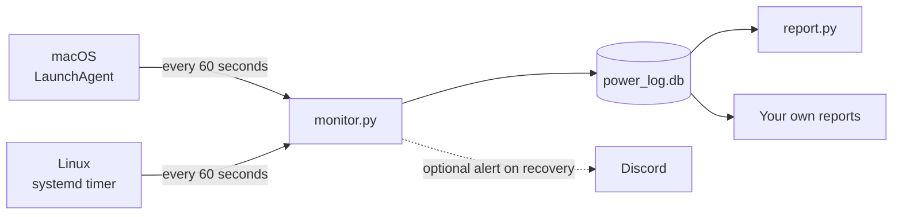

# ⚡ Power Monitor

**Learn when your power tends to go, so you can be charged before it does.**

When cuts are frequent, each one can feel random. Power Monitor lets a Mac or a Raspberry Pi keep the record for you. It logs the power cuts automatically, with no extra hardware, so you can look at the pattern instead of guessing.

## What it solves

A record of your own cuts helps you:

- **See when cuts usually happen**, by hour of day and day of week.
- **Plan your work** around the risky hours, such as calls, deadlines and long uploads.
- **Charge in time.** Keep laptops, phones, power banks and the inverter topped up, so a cut does not turn into a bigger problem.

Here is the kind of insight a report on that record can give. The examples come from my home in Lucknow:

| Question | Example from 398 cuts in 165 days |
|---|---|
| How often is there a cut? | On 76% of days |
| How much of the time was the power on? | 97.11% uptime |
| What are the worst hours? | 14:00 to 18:00 was the busiest four-hour window, with nearly a third of all cuts |
| Which weekday is worst? | Friday |
| How long is a typical cut? | Around 8 minutes |
| How bad can it get? | About 4 hours |

See [an example report from my home](https://print.devnadeem.com/reports/power-report.html).

---

## Who it is for

**Homes and small offices where power cuts are frequent**, with a Mac, a Raspberry Pi or another Linux machine that can stay switched on.

- It is **not useful where power rarely goes out**. There will be no pattern to find.
- It is **not for servers or data centers**. Those already have UPS and monitoring.

The machine has to lose power when you do. A laptop running on battery, or any machine behind a UPS, inverter or power bank, can stay on through a cut, and that cut will not be recorded.

---

## Platforms

| | macOS | Linux and Raspberry Pi |
|---|---|---|
| Systems | macOS | Raspberry Pi OS, Debian, Ubuntu |
| Scheduler | LaunchAgent | systemd service and timer |
| Starts | At login | At boot, no login needed |
| Runs as | Your user | Your user, not root |
| Logs | `monitor.log` and `monitor_error.log` | System journal |
| Installer | `setup.sh` | `setup-linux.sh` |

The login difference matters after a power cut. A Mac records nothing until someone is logged in. A Linux machine resumes without a login, once it has booted and its clock has synced over the network. A PC or mini PC may need a firmware setting to power on again after a cut.

---

## Set it up once, then it runs itself

After setup there is nothing to open or remember.

- `monitor.py` runs by itself **every 60 seconds**.
- On **macOS** it starts at login. On **Linux** it starts at boot, with nobody logged in.
- Each cut is saved to a local database, `power_log.db`, when the machine is running again.
- **Discord is optional.** Add a webhook if you want an alert when power returns. Cuts are still recorded without it.

For unattended use of a Mac, set it to start up automatically after a power failure and to log in automatically. `setup.sh` does not change either setting, and automatic login has security trade-offs you should weigh.

---

## Quickstart

You need Python 3.9 or newer. Pick your platform. In both, if there is no `.env` file, the installer creates one from the template and stops without installing or starting anything. Edit the file and run it again.

### macOS

```bash
git clone https://github.com/nadeemcite/power-monitor.git
cd power-monitor

# Create the virtual environment and try the report with made-up data
python3 -m venv venv
venv/bin/python3 -m pip install -r requirements.txt
venv/bin/python3 report.py --demo

# Configure, then start monitoring
cp .env.example .env
# Edit .env before the next step: paste your webhook URL, or leave the value empty
bash setup.sh
```

`setup.sh` reuses `venv/` (or creates it), installs the requirements, installs the LaunchAgent and starts monitoring.

Check that it is running. A new line should appear about once a minute:

```bash
tail -f monitor.log
```

### Linux and Raspberry Pi

```bash
sudo apt update
sudo apt install -y git python3 python3-venv

git clone https://github.com/nadeemcite/power-monitor.git
cd power-monitor

# Create the virtual environment and try the report with made-up data
python3 -m venv venv
venv/bin/python3 -m pip install -r requirements.txt
venv/bin/python3 report.py --demo

# Configure, then start monitoring
cp .env.example .env
# Edit .env before the next step: paste your webhook URL, or leave the value empty
nano .env
bash setup-linux.sh    # no sudo in front, it asks when it needs it
```

`setup-linux.sh` reuses `venv/` (or creates it), installs the requirements, installs a systemd service and timer, and starts the timer. The Python script runs as the user who ran the installer. `sudo` is used only to install and manage the units.

Check that it is running. A new heartbeat line should appear about once a minute. If you see nothing, try the second command with `sudo`:

```bash
systemctl list-timers power-monitor.timer
journalctl -u power-monitor.service -f
```

---

## Raspberry Pi tips

- **Power it directly** from the supply you want to watch. Behind a UPS or power bank, the Pi stays on through a cut and records nothing.
- **It should come back by itself.** A Raspberry Pi normally turns on as soon as power is connected. A Pi 5 can be set to wait for its power button (`WAIT_FOR_POWER_BUTTON`), so leave that at its default of `0`. Test your setup once by unplugging it and plugging it back in.
- **It needs network time after a cut.** Many Raspberry Pi boards have no real-time clock. The Pi 5 has one, but it needs a backup battery to keep running without mains power. To avoid writing a wrong time, heartbeats wait until the clock has synced after each boot, on any model. If your router or internet takes longer to return than the Pi, that wait is counted as part of the cut.
- **Set your time zone**, so hours and weekdays in reports are right. For example: `sudo timedatectl set-timezone Asia/Kolkata`.
- **Back up `power_log.db`** now and then. Sudden power loss can corrupt storage, including an SD card.

---

## Make your own reports

This repository collects the data in `power_log.db`. You can build reports from it however you like: a spreadsheet, a script, a notebook or an AI agent.

To use an agent, paste the prompt below into your own, for example Grok Bot, Hermes, or any agent that can read a file and run on a schedule. Replace `PATH_TO` with the location of your project folder.

```text
Create a power cut report from my Power Monitor database, and repeat it every week.

DATA
- SQLite file: PATH_TO/power-monitor/power_log.db
- Open it read-only. Do not change it, and do not read the .env file in that folder.
- Table "outages": id, start_time, end_time, duration_seconds, notified
- Table "pings": id, timestamp (a heartbeat, about one every 60 seconds)
- start_time, end_time and timestamp are Unix epoch seconds. Convert them to
  this computer's local time.

CLEANING
- Outage rows with the same start_time are one cut recorded more than once.
  Keep only the row with the earliest end_time.
- A gap can also come from sleep, a restart or a shutdown. Point out any cut
  that looks unusual, and do not claim to know its cause.

PERIODS
- This period: the last 7 complete days.
- Previous period: the 7 days before that.
- Also work out all-time figures for context.
- If there is not enough history for a figure or comparison, say so instead
  of estimating.

REPORT
1. Summary numbers for this period and all time: number of cuts, total time
   without power, uptime percentage and longest cut.
   Uptime = 100 x (1 - time without power / monitored time). Monitored time is
   the part of the period between the first and last heartbeat in the database.
   Count only the part of each cut that falls inside the period.
2. Worst hours and weekdays: rank them by number of cuts and by time without
   power, and name the worst 4-hour window. Use all-time data for the pattern,
   then say how this period differed.
3. Duration percentiles: median, 75th, 90th and 95th, plus the longest.
4. Share of days with at least one cut.
5. Trend: compare this period with the previous one and say whether things got
   better, got worse or stayed about the same.
6. Practical advice: when to have laptops, phones, power banks and the
   inverter charged, and which hours to avoid for important work. Base this
   only on the data, and say how confident you are given the number of cuts.

OUTPUT
- Plain language, readable in two minutes, with the numbers in a small table.
- Send the report to me. Do not save it inside the power-monitor folder, and
  do not share the report or the database with anyone else.

SCHEDULE
- Run this every Monday at 09:00. If the computer was off then, run it at the
  next chance.
```

You can **schedule that agent to run regularly**, such as once a week, using its own scheduling feature. It needs access to the database file, and the computer holding that file has to be on when it runs.

---

## Built-in report

`report.py` is a simple built-in option that prints a terminal summary and saves a `report.png`.

```bash
venv/bin/python3 report.py          # terminal summary and report.png
venv/bin/python3 report.py --text   # terminal summary only
venv/bin/python3 report.py --demo   # made-up data, summary and report.png
```

- **Terminal summary:** monitoring period, heartbeat count, number of outages, total downtime, uptime percentage, longest, average and shortest cut, and the full outage log.
- **Charts:** duration over time, outages by hour of day, cumulative downtime and duration distribution.


*The output of `report.py --demo`. The data in this image is made up.*

Demo mode builds 30 days of synthetic data in memory and never reads or writes `power_log.db`. It does overwrite `report.png`. Add `--text` to skip the chart. A chart of your own data is only written once at least one outage has been recorded.

---

## How detection works



Every minute, `monitor.py` saves a heartbeat. A machine without power cannot write one. On the next run, if the gap since the last heartbeat is **more than 3 minutes** (180 seconds), the script records an outage and, if Discord is configured, tries to send an alert.

- An outage is recorded **on recovery**, not while the power is still out.
- **Start time** is the last heartbeat before the gap, up to about a minute before the real cut.
- **End time** is the first run after the machine is back. On macOS the duration includes boot and login time. On Linux it includes boot time and the wait for the clock to sync.

---

## Limitations

- **It measures gaps, not electricity.** Sleep, a reboot, a shutdown, a long OS update or a stopped scheduler look like a cut if the gap is longer than 3 minutes. So does a clock that jumps forward that far. Stop the machine from sleeping.
- **Backup power hides cuts.** A battery, UPS, inverter or power bank that keeps the machine on means nothing is recorded.
- **macOS needs a logged-in session.** The LaunchAgent logs nothing until someone is logged in. This does not apply to Linux, where the timer starts at boot.
- **Linux needs a clock sync after each boot.** Nothing is recorded until the system reports that its clock is synchronized. On a machine that never syncs, nothing is recorded at all. If yours is offline but has a reliable battery-backed clock, remove the `ExecCondition` line from `systemd/power-monitor.service` and run `setup-linux.sh` again.
- **Short cuts can be missed.** Gaps of 3 minutes or less are ignored.
- **Discord alerts are not retried.** If sending fails, for example because the router is still starting, the outage stays in the database but the alert is lost.
- **Some send errors cause duplicates.** After a dropped connection, or with a webhook URL missing `https://`, the same cut can be recorded again on each run until one run succeeds. Check `monitor_error.log` on macOS, or the journal on Linux. Emptying `DISCORD_WEBHOOK_URL` stops the repeats.

---

## Configuration

Settings live in `.env`, which has one key:

| Key | Required | Purpose |
|---|---|---|
| `DISCORD_WEBHOOK_URL` | No | Where to send the alert when power returns |

To use Discord, [create a webhook](https://support.discord.com/hc/en-us/articles/228383668) and paste the URL after the `=` with no quotes. To skip it, leave the value empty. The file is read on every run, so changes apply within a minute.

The 3-minute threshold is set in `monitor.py`:

```python
OUTAGE_THRESHOLD_SECONDS = 180
```

---

## Scheduling

### macOS

`setup.sh` fills in the paths in `com.powermonitor.plist` and installs it to `~/Library/LaunchAgents/`. The agent runs `monitor.py` when it loads and then every 60 seconds. If you move the project folder, run `setup.sh` again.

```bash
# Stop
launchctl unload ~/Library/LaunchAgents/com.powermonitor.plist

# Start
launchctl load ~/Library/LaunchAgents/com.powermonitor.plist

# Restart
launchctl unload ~/Library/LaunchAgents/com.powermonitor.plist
launchctl load ~/Library/LaunchAgents/com.powermonitor.plist

# Uninstall the agent (keeps your data, .env, logs and venv)
bash uninstall.sh
```

### Linux

`setup-linux.sh` fills in the user and paths in `systemd/power-monitor.service` and installs it with `systemd/power-monitor.timer` to `/etc/systemd/system/`. The timer runs the service shortly after boot, then again 60 seconds after each run finishes or is skipped. If you move the project folder, run `setup-linux.sh` again.

```bash
# Stop until the next reboot
sudo systemctl stop power-monitor.timer

# Start
sudo systemctl start power-monitor.timer

# Restart
sudo systemctl restart power-monitor.timer

# Stop and keep it off after reboots
sudo systemctl disable --now power-monitor.timer

# Turn it back on
sudo systemctl enable --now power-monitor.timer

# Uninstall the units (keeps your data, .env, logs and venv)
bash uninstall-linux.sh
```

Some systems do not keep the journal across reboots. Your outage history is in `power_log.db` either way.

On either platform, if monitoring is stopped for more than 3 minutes, the next run records that gap as an outage.

---

## Privacy

- Heartbeats and outages stay in a local SQLite file, `power_log.db`. Logs go to `monitor.log` and `monitor_error.log` on macOS, and to the system journal on Linux.
- The database, logs, `.env` and `report.png` are gitignored. **Do not commit them.** Your webhook URL is a secret, and an outage history shows when your home was without power.
- `monitor.py` and `report.py` send nothing over the network except the Discord alert, if you configure it. Each alert includes the outage number, start time, end time and duration.
- If you give an AI agent access to your database, what it reads may be sent to that agent's provider.

---

## Files

```text
power-monitor/
├── monitor.py              # Heartbeat, outage detection, Discord alert
├── report.py               # Terminal summary, charts and demo mode
├── requirements.txt        # Python dependencies (matplotlib)
├── setup.sh                # Installer for macOS
├── uninstall.sh            # Removes the LaunchAgent
├── com.powermonitor.plist  # LaunchAgent template
├── setup-linux.sh          # Installer for Linux
├── uninstall-linux.sh      # Removes the systemd units
├── systemd/
│   ├── power-monitor.service  # Service template
│   ├── power-monitor.timer    # Runs the service every 60 seconds
│   └── clock-ready.sh         # Waits for clock sync after boot
├── .env.example            # Config template, copy to .env
├── .gitignore
├── docs/
│   └── report-demo.png     # Sample chart made from synthetic data
├── LICENSE
└── README.md
```

Created at runtime and gitignored:

```text
venv/
.env
power_log.db
monitor.log
monitor_error.log
report.png
```

---

## Contributing

Pull requests are welcome. Some ideas: retrying failed alerts, other notification channels, and Windows support.

---

## License

[MIT](LICENSE) © 2026 Nadeem Sajjad
