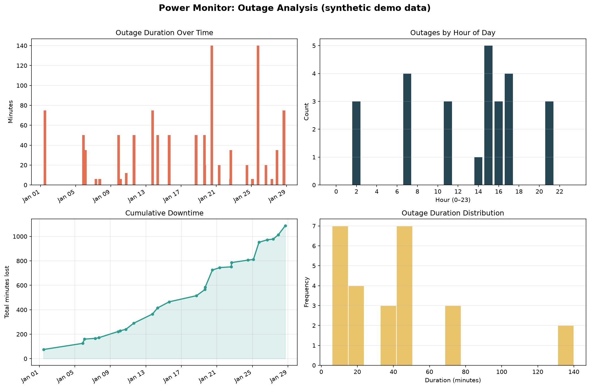
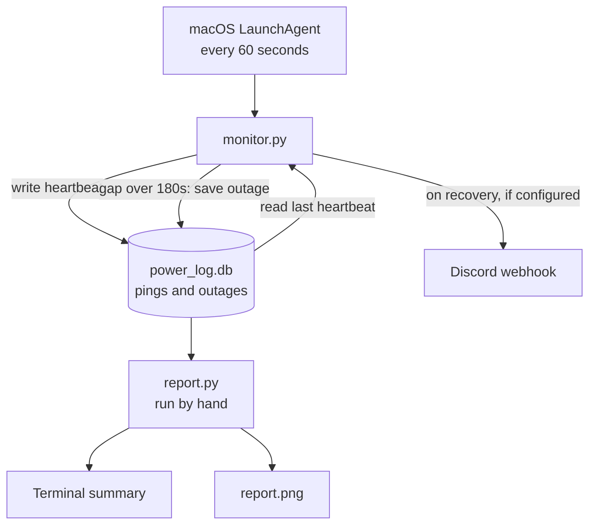

# ⚡ Power Monitor

**The power-cut sensor is the thing that loses power.** A Mac mini at home in Lucknow writes a heartbeat about itself to a local database every 60 seconds. When the electricity goes, the heartbeat stops. When the machine is running again, a small Python script finds the gap, records how long it lasted, and can tell you on Discord. No extra hardware, just a computer noticing that it was gone.

**[See a live report built from real data from this setup](https://print.devnadeem.com/reports/power-report.html)**



*A `report.png` produced by `report.py --demo`. The data in this image is made up.*

---

## A real-world example

The [published report](https://print.devnadeem.com/reports/power-report.html) is a snapshot covering 14 June 2026 to 26 November 2026:

| Measure | Value |
|---|---|
| Outages | 398 |
| Uptime | 97.11% |
| Longest cut | About 4 hours |
| Days with a cut | 76% |
| Worst 4-hour window | 14:00 to 18:00 |
| Worst weekday | Friday |

That page also has an AI verdict and richer charts. **The code in this repository does not generate those extras**, and it does not publish anything. What you get from this repo is:

- a local SQLite log
- a Discord alert when power returns
- a terminal summary
- a `report.png` with four charts

Outage count, uptime and longest cut are part of the terminal summary. The share of days with a cut, the worst 4-hour window and the worst weekday are not calculated by `report.py`.

---

## How it fits together



---

## Features

- **Heartbeat every 60 seconds**, run by a macOS LaunchAgent. `monitor.py` uses only the Python standard library.
- **Outage records** with start time, end time and duration, stored in SQLite.
- **Discord alert on recovery** (optional) with the start, end and duration of the cut.
- **Terminal summary:** monitoring period, heartbeat count, number of outages, total downtime, uptime percentage, longest, average and shortest cut, and the full outage log.
- **Charts** saved to `report.png`: duration over time, outages by hour of day, cumulative downtime and duration distribution.
- **Demo mode** to see a report without any real data.

---

## How detection works

Each time `monitor.py` runs, it:

1. reads the time of the last heartbeat from the database,
2. compares it with the current time,
3. records an outage if the gap is **more than 3 minutes** (180 seconds), and tries to send the Discord alert,
4. saves a new heartbeat.

The machine cannot write anything while it is off, so an outage is only recorded **on recovery**. There is no alert while the power is still out.

- **Start time** is the last heartbeat before the gap, which can be up to about a minute before the real cut.
- **End time** is the first run after the machine is back, so the duration includes boot and login time.
- **Short cuts** can be missed. A gap of 180 seconds or less is ignored.

To change the threshold, edit this line in `monitor.py`:

```python
OUTAGE_THRESHOLD_SECONDS = 180
```

### What else looks like a power cut

The script measures gaps, not electricity. **Sleep, a reboot, a shutdown, a long OS update, or stopping the agent** will all be recorded as an outage if the gap is longer than 3 minutes. A clock that jumps forward by more than 3 minutes can do the same. For useful data, stop the Mac from sleeping.

A macOS **LaunchAgent runs in a logged-in session**. After a real cut, heartbeats resume only once the Mac has powered on and a user is logged in. For unattended use, set the Mac to start up automatically after a power failure and to log in automatically. `setup.sh` does not change either setting, and automatic login has security trade-offs you should weigh.

### Known limitations

- The Discord alert is tried once. If it fails, for example because your router is still starting, it is not sent again. The outage stays in the database.
- Some send errors, such as a dropped connection or a webhook URL without `https://`, stop the script before it saves the new heartbeat. Each following run then records that outage again, with a longer duration, until one run gets through. Check `monitor_error.log` if you see duplicates. Emptying `DISCORD_WEBHOOK_URL` stops the repeats.

---

## Quickstart

You need Python 3.9 or newer. Real monitoring needs macOS.

```bash
git clone https://github.com/nadeemcite/power-monitor.git
cd power-monitor

# Create the virtual environment and try the report with made-up data
python3 -m venv venv
venv/bin/python3 -m pip install -r requirements.txt
venv/bin/python3 report.py --demo

# Configure, then start monitoring (macOS)
cp .env.example .env
# Edit .env before the next step: paste your webhook URL, or leave the value empty
bash setup.sh
```

`setup.sh` reuses `venv/` (or creates it), installs the requirements, installs the LaunchAgent and starts monitoring. If there is no `.env` file, it creates one from the template and stops without installing or starting the agent. Edit the file and run it again.

Check that it is running:

```bash
tail -f monitor.log
```

A new line should appear about once a minute.

---

## Generating a report

```bash
venv/bin/python3 report.py          # terminal summary and report.png
venv/bin/python3 report.py --text   # terminal summary only
venv/bin/python3 report.py --demo   # made-up data, summary and report.png
```

Demo mode builds 30 days of synthetic data in memory and never reads or writes `power_log.db`. It does overwrite `report.png`. Add `--text` to skip the chart.

A real chart is only written once at least one outage has been recorded. Until then, an older `report.png` is left as it is.

---

## Configuration

Settings live in `.env`, which has one key:

| Key | Required | Purpose |
|---|---|---|
| `DISCORD_WEBHOOK_URL` | No | Where to send the alert when power returns |

Discord is optional. Without it, outages are still recorded; leave the value empty. To use it, [create a webhook](https://support.discord.com/hc/en-us/articles/228383668) and paste the URL after the `=` with no quotes. The file is read on every run, so changes apply within a minute.

An alert looks like this (example values):

```text
⚡ Power Restored
Back online after 1h 14m 8s without power.

🔴 Outage started: 2026-01-15 15:32:55
🟢 Power restored: 2026-01-15 16:47:03
⏱ Duration: 1h 14m 8s

Outage #1 • Power Monitor
```

---

## Scheduling

Scheduling uses macOS `launchd`. `setup.sh` fills in the paths in `com.powermonitor.plist` and installs it to `~/Library/LaunchAgents/`. The agent runs `monitor.py` when it is loaded and then every 60 seconds. If you move the project folder, run `setup.sh` again.

```bash
# Stop
launchctl unload ~/Library/LaunchAgents/com.powermonitor.plist

# Start
launchctl load ~/Library/LaunchAgents/com.powermonitor.plist

# Restart
launchctl unload ~/Library/LaunchAgents/com.powermonitor.plist
launchctl load ~/Library/LaunchAgents/com.powermonitor.plist

# Uninstall the agent (keeps your data, .env, logs and venv)
bash uninstall.sh
```

If the agent is stopped for more than 3 minutes, the next run records that gap as an outage.

---

## Privacy

- Heartbeats and outages stay in a local SQLite file, `power_log.db`. Logs go to `monitor.log` and `monitor_error.log`.
- The database, logs, `.env` and `report.png` are gitignored. **Do not commit them.** Your webhook URL is a secret, and an outage history shows when your home was without power.
- If you configure Discord, each alert sends the outage number, start time, end time and duration to Discord.
- Nothing here uploads reports. The live HTML report linked above is a separately published snapshot.

---

## Files

```text
power-monitor/
├── monitor.py              # Heartbeat, outage detection, Discord alert
├── report.py               # Terminal summary, charts and demo mode
├── requirements.txt        # Python dependencies (matplotlib)
├── setup.sh                # Installer for macOS
├── uninstall.sh            # Removes the LaunchAgent
├── com.powermonitor.plist  # LaunchAgent template
├── .env.example            # Config template, copy to .env
├── .gitignore
├── docs/
│   └── report-demo.png     # Sample chart made from synthetic data
├── LICENSE
└── README.md
```

Created at runtime and gitignored:

```text
venv/
.env
power_log.db
monitor.log
monitor_error.log
report.png
```

---

## Contributing

Pull requests are welcome. Some ideas: retrying failed alerts, other notification channels, and Linux or Windows scheduling.

---

## License

[MIT](LICENSE) © 2026 Nadeem Sajjad
